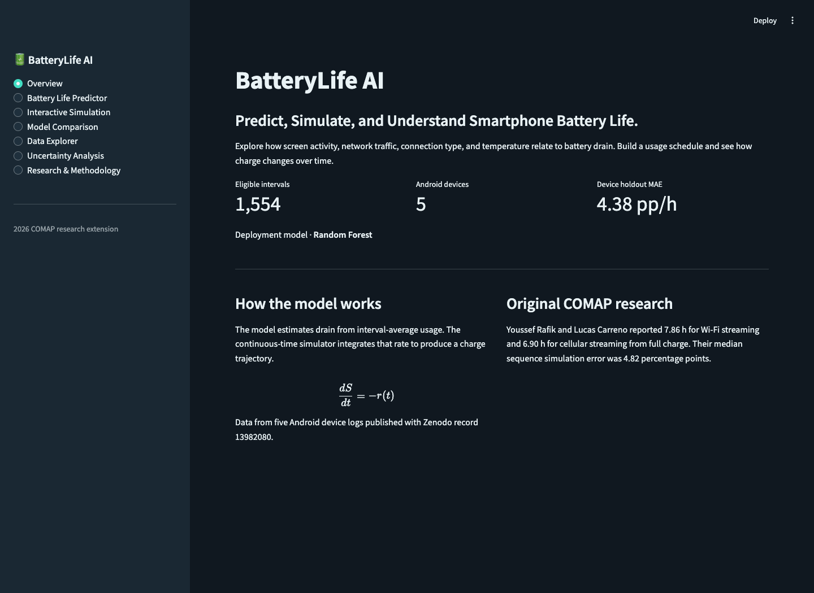
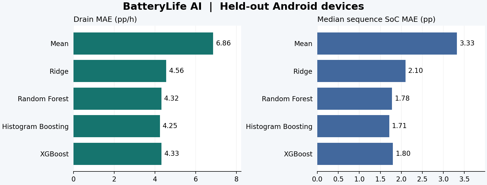
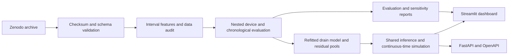
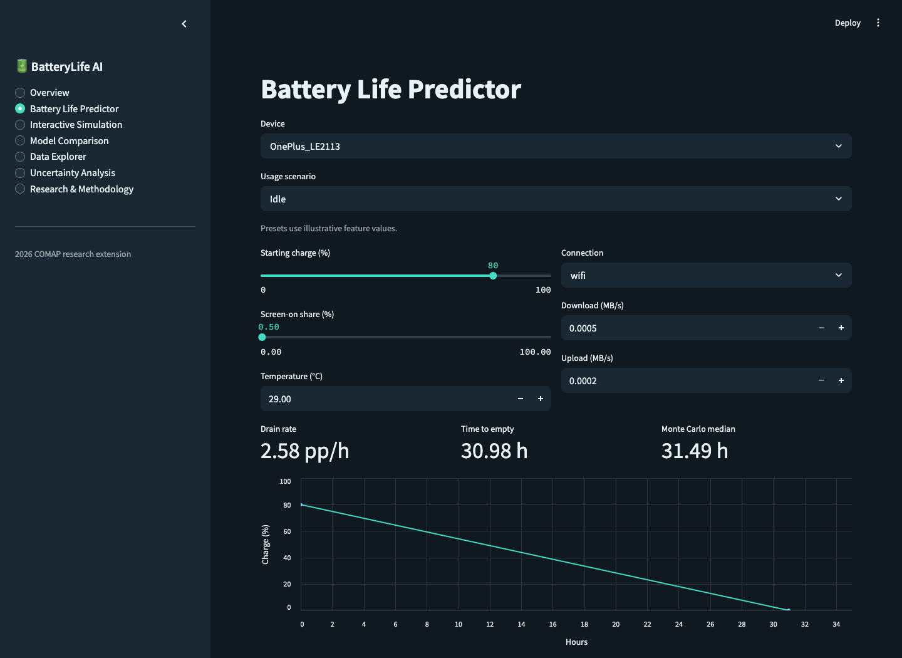
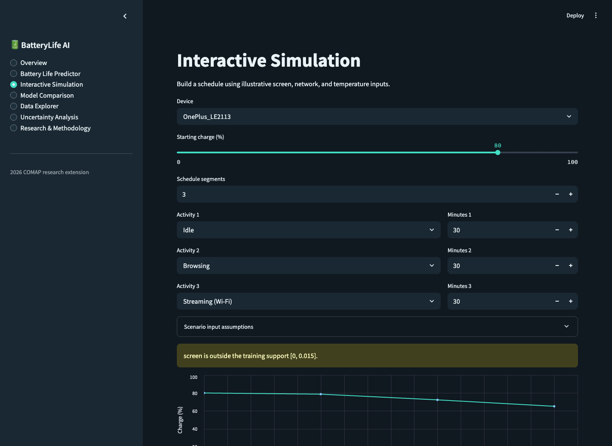

# BatteryLife AI

BatteryLife AI models Android battery drain from telemetry and integrates
the predicted rate into charge trajectories. Explore usage scenarios in a
seven-page Streamlit dashboard or call the same prediction engine through
FastAPI. Everything runs locally on CPU.

[Live demo](https://battery-life-ai-6mq6c4rpbpiyrt3mqvuyhl.streamlit.app/) · [Source code](https://github.com/youssefrafik6/battery-life-ai) · [Methodology](docs/methodology.md)



## Verified evaluation

The extension used **1,554 eligible intervals across five Android devices**.
Outer folds held out one entire device at a time. Drain errors are averaged
equally across devices. The SoC column is the median trajectory MAE across
198 contiguous held-out sequences.

| Model | Drain MAE (pp/h) | Drain RMSE (pp/h) | Median sequence SoC MAE (pp) |
|---|---:|---:|---:|
| Training mean | 6.86 | 8.03 | 3.33 |
| Log-Ridge | 4.56 | 6.37 | 2.10 |
| Random Forest | 4.32 | 5.76 | 1.78 |
| Histogram Boosting | 4.25 | 5.61 | 1.71 |
| XGBoost | 4.33 | 5.75 | 1.80 |
| Nested selection procedure | 4.38 | 5.73 | 1.75 |

Random Forest won the grouped deployment search. Histogram Boosting led
the outer comparison, and Ridge led the chronological known-device test
with a pooled MAE of 3.90 pp/h. Five devices leave considerable uncertainty
in the ranking. There were no eligible held-out sequences ending at a
recorded zero, so empirical time-to-empty MAE is unavailable. Fold R²,
timing, residual diagnostics, and sensitivity results are in [results](results/).



The original **2026 COMAP MCM Problem A** report by **Youssef Rafik and
Lucas Carreno** reported a 4.82 pp median sequence MAE and full-charge
streaming estimates of 7.86 h on Wi-Fi and 6.90 h on mobile. Those figures
came from the contest methodology. Direct improvement claims require
matching its evaluation population and protocol. This repository is a
later software engineering extension by **Youssef Rafik**.
See [the historical research summary](docs/original_research.md).

## Architecture



### Battery model

The state of charge $S$ is a percentage, with time in hours and drain
$r$ in percentage points per hour.

$$
\frac{dS}{dt}=-r(t),\qquad
S_{k+1}=\max(0,S_k-r_k\Delta t_k).
$$

For constant drain, $T=S_0/r$ when $r>0$. A time-varying usage schedule is
integrated segment by segment with an exact zero crossing. Piecewise-constant
rates have a closed form and require no numerical ODE solver.

### Data and machine learning

The pipeline verifies the download checksum and five CSV schemas, normalizes
network labels, detects charging, counter resets and large gaps, and
converts snapshot differences into interval-level screen and network rates.
Fold-local imputation, quantile clipping and encoding prevent preprocessing
leakage. The CLI supports the historical 300 s minimum interval, 30 pp/h
training cap and 0.99 feature winsorization. The default maximum gap is two
hours. [Read the methods and uncertainty assumptions](docs/methodology.md).

The dataset is *Enhancing Smartphone Battery Life: A Deep Learning Model
Based on User-Specific Application and Network Behaviour*, Daniel
Flores-Martin, Sergio Laso Mangas, and Juan Luis Herrera (2024),
[Zenodo DOI 10.5281/zenodo.13982080](https://doi.org/10.5281/zenodo.13982080),
licensed [CC BY 4.0](https://creativecommons.org/licenses/by/4.0/).
The five source files are identified in [Data and attribution](data-attribution.md).
The app ships a frozen serving model and a reduced explorer table with
relative times. The original logs and full local interval exports stay local.

## Run locally

Use Python 3.13 to reproduce the verified environment. On Apple Silicon,
install Homebrew `libomp` if XGBoost needs it. The core workflow runs
without XGBoost by installing `.[dev]` and omitting the `--xgb` flag.

```bash
python3.13 -m venv .venv
source .venv/bin/activate
python -m pip install -e '.[dev,xgb]' -c configs/verified-constraints.txt
export OMP_NUM_THREADS=1
batterylife download
batterylife prepare --config configs/default.json
batterylife train --config configs/default.json --xgb
batterylife sensitivity --config configs/default.json
streamlit run dashboard/app.py
```

Open [the local dashboard](http://localhost:8501). Explore the predictor,
schedule simulator, model comparisons, data explorer, uncertainty and
research pages. Scenario presets are illustrative feature combinations.
The predictor reports support warnings, feature contributions and Monte
Carlo percentiles.





### API

From the same activated environment, run `uvicorn api.main:app` and open
[local Swagger UI](http://localhost:8000/docs).

| Endpoint | Function |
|---|---|
| `GET /health` | Model readiness |
| `GET /model-info` | Active model, devices, and input bounds |
| `POST /predict` | Constant-drain prediction and uncertainty |
| `POST /simulate` | Piecewise schedule integration |
| `POST /batch-predict` | Up to 100 prediction requests |
| `GET /evaluation` | Saved experimental results |

```bash
curl -sS http://localhost:8000/predict \
  -H 'Content-Type: application/json' \
  -d '{"device":"OnePlus_LE2113","screen":0.1,"network":"wifi","download":0.025,"upload":0.003,"temperature":32,"start_soc":80}'
```

Screen is a fraction, network rates are MB/s, temperature is °C, and
starting charge is percent. Schedule segments add `minutes`. Invalid
requests return 422. Missing model artifacts return 503 on prediction
routes. Load only locally generated model artifacts.

### Docker

```bash
docker compose build api
docker compose run --rm pipeline download
docker compose run --rm pipeline prepare
docker compose run --rm pipeline train --xgb
docker compose run --rm pipeline sensitivity
docker compose up -d api dashboard
```

Services bind to localhost on ports 8000 and 8501. Compose persists
`data/` and `results/` on the host. Stop with `docker compose down`.
For Streamlit Community Cloud, deploy `dashboard/app.py` from `main`.
The adjacent requirements file pins the serving estimator version. Predictions,
simulations, and the explorer use bundled artifacts as soon as the app opens.
Local training outputs take precedence, and `BATTERYLIFE_MODEL` can point to
another trusted model file.
[Community Cloud deployment guide](https://docs.streamlit.io/deploy/streamlit-community-cloud/deploy-your-app/deploy).

### Checks

```bash
ruff check .
pytest -q
python scripts/plot_evaluation.py
docker compose config --quiet
```

The stack uses Python, pandas, NumPy, Pydantic, scikit-learn, optional
XGBoost, Altair, Streamlit, FastAPI, Docker, pytest, Ruff, and GitHub Actions.
See [verification](docs/verification.md).

## Limits and future work

Device and user effects are confounded across five observational traces.
Brightness, battery health, processor power, GPS, radio signal, and future
behavior are unobserved. Held-out simulations use realized interval features.
Monte Carlo bands reflect empirical residual variation, and the block bootstrap
reflects refit variability conditional on these devices. Time-to-empty calibration
needs observed depletion cycles. Future work could collect those cycles,
validate on a wider device cohort, test additional dependence structures,
and incorporate battery-health measurements.

The repository code is [MIT licensed](LICENSE). The original report and
third-party dataset carry their own rights and attribution.

## Author

Youssef Rafik
